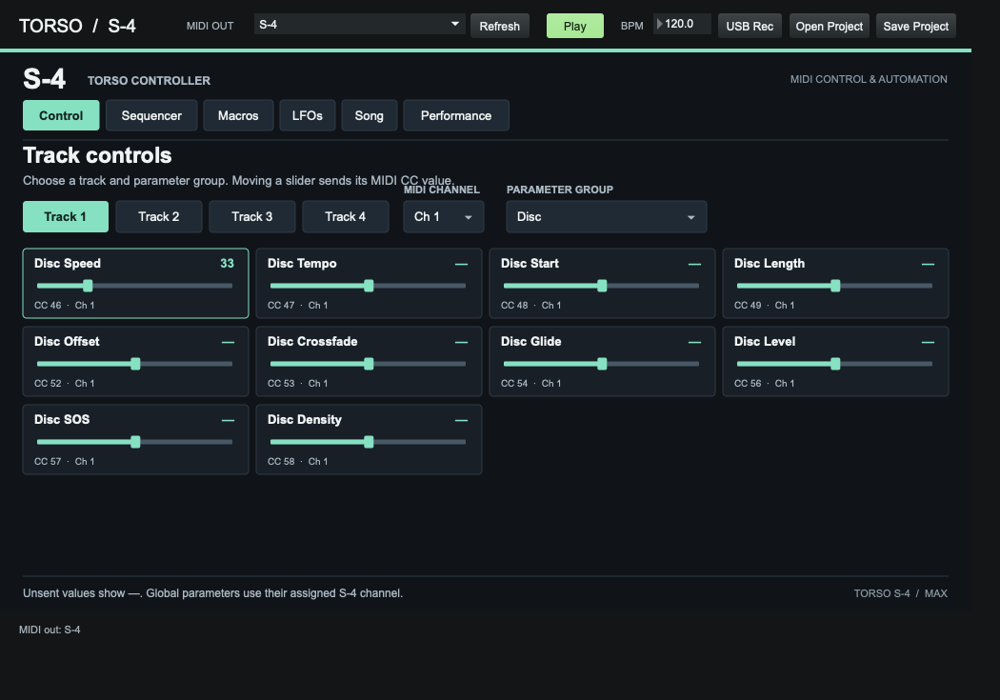
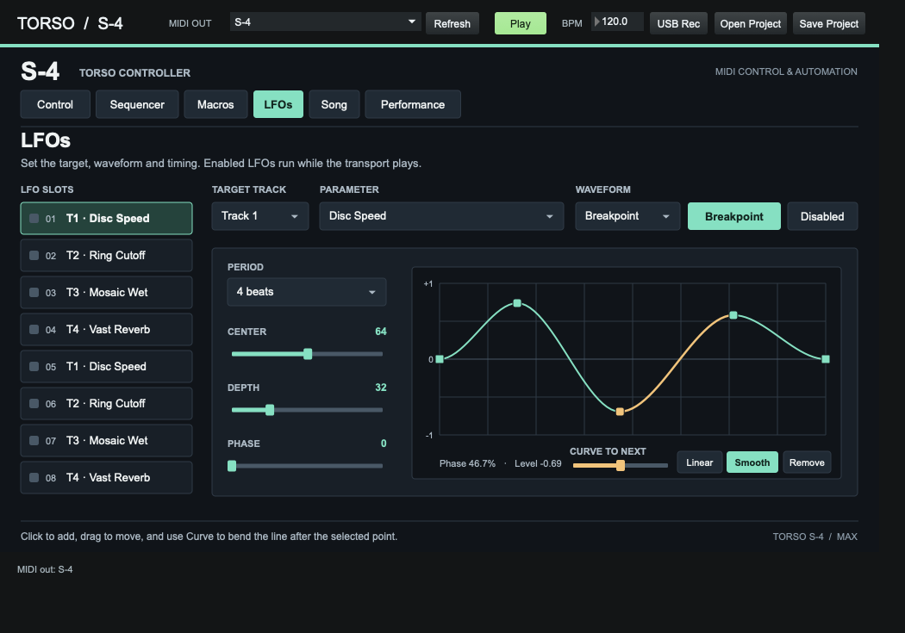
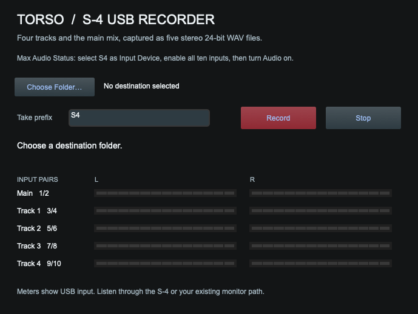

# Torso S-4 for Max

Control the Torso S-4 from Cycling ’74 Max with step sequencing, drawable LFOs, macros, and an XY pad. The companion USB recorder saves the four stereo tracks and stereo main mix as separate, aligned WAVs.

**[Download the latest release](https://github.com/modelcollapse/torso-s4-max/releases/latest)** · First release: `v0.1.0`

## Get started

1. Unzip `Torso-S4-Max-v0.1.0.zip` and open [Torso S4 Max.maxpat](Torso%20S4%20Max.maxpat). Keep the files together. Tested with Max 9.2 on macOS, with no additional packages.
2. Connect the S-4 over USB-C with a data cable in **Device** mode, or connect its MIDI input to a MIDI interface for control only. On the S-4, turn on **CONFIG → MIDI → CC CONTROL**.
3. Select the device under **MIDI OUT**. Use **Refresh** if you connected it after opening the patch. In **Control**, match the four track channels to the S-4. They start at 1–4. Perform uses channel 15 and Mix uses channel 16.
4. Choose the material active on your S-4 track and move a slider. Materials and modulator types can share CC numbers, so the active type determines which control responds.

## Controls and automation

| Tab | Use |
| --- | --- |
| Control | Send MIDI CC values to track, Mix, and Perform parameters. |
| Sequencer | Draw values in eight lanes of up to 64 steps, with independent rates and directions. |
| Macros | Map up to four targets per macro. Set or invert each target’s range. |
| LFOs | Modulate parameters with preset waveforms or a drawn breakpoint curve. |
| Song | Draw automation points over a loop measured in beats. |
| Performance | Assign up to four targets to the XY pad’s two axes. |

**Play** starts the sequencer, LFOs, and Song together on Max’s clock. Start sample playback on the S-4 separately. **Save Project** and **Open Project** store and restore track settings, patterns, and mappings as JSON. Select your MIDI destination in each Max session.

In **LFOs**, choose **Breakpoint** to draw a waveform. Click to add a point, drag to move it, and use **Curve to next** to bend the line after the selected point. **Smooth** eases the segment and **Linear** straightens it. Match the endpoints’ heights for a continuous loop.

## Record USB audio

1. With the S-4 in USB **Device** mode, open **Options → Audio Status** in Max. Select the S-4 as input, set **48 kHz**, map logical inputs 1–10 to the corresponding hardware inputs, and turn on audio.
2. Click **USB Rec** or open [S4 USB Recorder.maxpat](S4%20USB%20Recorder.maxpat). Play the S-4 and check the input meters.
3. Click **Choose Folder**, optionally enter a take prefix, then click **Record**. Click **Stop** and wait for **Saved five stereo WAVs** before closing the recorder.

| S-4 signal | Max input pair |
| --- | --- |
| Main mix | 1/2 |
| Track 1 | 3/4 |
| Track 2 | 5/6 |
| Track 3 | 7/8 |
| Track 4 | 9/10 |

The recorder captures all ten channels in one pass and splits them into five sample-aligned stereo 24-bit WAVs. If splitting fails, the ten-channel WAV stays in the destination.

**USB validation:** A synthetic test verified channel order and alignment. One live S-4 take contained audio, but later takes were silent and the macOS input meter stayed flat. Make a short test take and play it back before recording a set.

If the meters stay flat, confirm the S-4 is audible at its own output. On macOS, check **Privacy & Security → Microphone** for Max and watch the S-4 input meter under **Sound → Input**. If that meter also stays flat, check the USB data cable, **Device** mode, and the S-4’s track mix levels. Listen through the S-4 or your usual monitor path.

## Source and compatibility

Both `.maxpat` files are editable. The companion JavaScript files cover the MIDI map, automation, Max interface, and WAV splitting. The MIDI map follows Torso’s published reference. Blocks, knob recording, and Spatial Field from the [Swift controller](https://github.com/modelcollapse/TorsoS4Controller) are outside this port.

[Torso S-4 MIDI reference](https://docs.torsoelectronics.com/s4/appendix/cc-mapping-and-midi-note-reference/) · [USB and MIDI connection guide](https://docs.torsoelectronics.com/s4/midi-and-analog-sync/midi-connectivity/) · [USB audio routing](https://docs.torsoelectronics.com/s4/miscellaneous/usb-audio-interface/)
